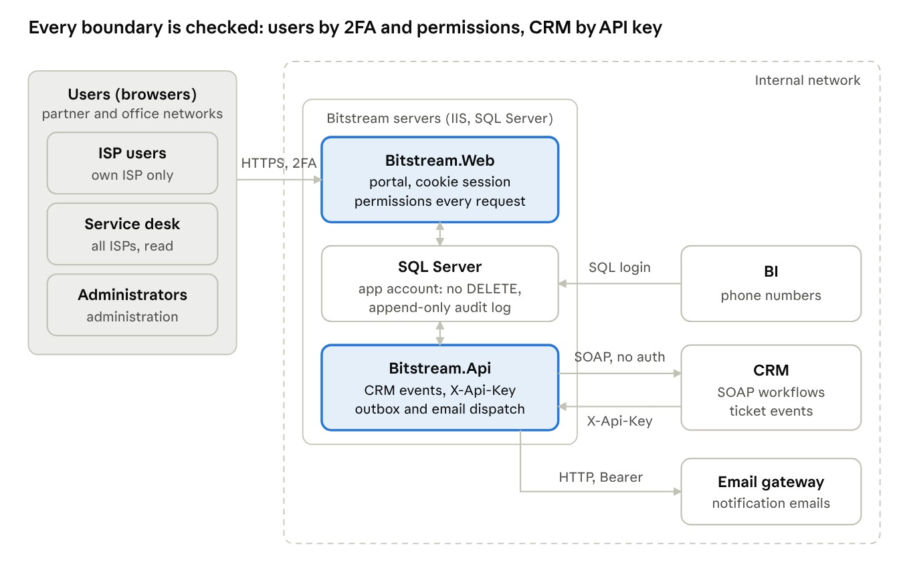

# Bitstream Portal — Security Overview

Version 1.1 · November 2026 · Schema version 23 · Internal — confidential

## Purpose and scope

The Bitstream Portal enforces security on the server at every layer: two-step sign-in for every user, permission checks on every request, strict per-ISP data isolation, an append-only audit log, and a database account that cannot delete or rewrite history. This document describes those controls as implemented in the current release, so the security team can review them, verify the production configuration, and decide on the open items listed at the end.

Scope:

- **Bitstream.Web** — the portal used by ISP users, the service desk and administrators (IIS, HTTPS).
- **Bitstream.Api** — the inbound API that CRM calls with ticket events, plus the background outbox and email dispatchers.
- **SQL Server database** — schemas `sec`, `portal`, `ops` (application data) and `dbo` (ASP.NET Core Identity tables).
- **Integrations** — CRM (SOAP workflows, outbound), CRM ticket events (inbound), the email gateway, and BI (active lines and phone numbers).

References such as TR-SEC-07 are the technical requirement IDs used in the code and the requirements document.

## Architecture and trust boundaries

There are three entry points, each with its own control: people reach only Bitstream.Web, after two-step sign-in; CRM reaches only Bitstream.Api's event endpoint, with an API key; BI writes only to its phone-number table.

Bitstream.Web serves the screens and their JSON endpoints. Bitstream.Api receives CRM events and runs the background dispatchers that call CRM and the email gateway. Both hosts use the same database account and the same Data Protection key ring, and neither accepts a request from the other.

## Authentication

Every user signs in with email, password and a one-time code; there is no way to skip the second step. Authentication uses ASP.NET Core Identity with a custom Argon2id password hasher.

| Control | Implementation | Setting |
| --- | --- | --- |
| Password storage | Argon2id hash per user (never reversible) | 19,456 KB memory, 2 iterations, parallelism 1 (OWASP minimum) |
| Password length | Enforced on every set or change | At least 12 characters |
| Password complexity | Character classes: lowercase, uppercase, digit, symbol | At least 3 of 4 |
| Password reuse | Previous hashes kept in `sec.UserPasswordHistory` | Last 5 refused |
| Common passwords | Built-in deny list, extendable in configuration | `Security:PasswordPolicy:AdditionalDeniedPasswords` |
| Two-step verification | Required for every account (`TwoFactorEnabled = true` on creation) | Channel `Totp` (authenticator app); `EmailOtp` / `SmsOtp` supported |
| Authenticator enrolment | QR code shown at the first sign-in after a valid password; the key is stored encrypted with Data Protection | — |
| Account lockout | Identity lockout after failed password or code attempts | 5 attempts, then locked until an administrator unlocks |
| Brute-force throttling | Rate limit on the sign-in endpoints | 20 requests per 60 s (see open items) |

The policy floors are validated at start-up: a configuration weaker than 12 characters, 3 classes or 5 remembered passwords stops the application from starting.

### Remember me

"Remember me on this device" stores only the **email address** in the browser's local storage. The password is offered to the browser's own password manager through the Credential Management API; the portal never stores it. The one-time code is requested at every sign-in.

### Password changes and resets

- A user changes their own password from the user menu; the current password is required, and every other session of that user is signed out.
- An administrator can set a new password for a user (User Administration › New password). The same policy applies.
- The sign-in page only redirects to a local return URL, so it cannot be used as an open redirect.

## Session management

A session ends after 30 minutes without activity or 12 hours after sign-in, whichever comes first, and permission or lock changes apply on the very next request.

| Control | Implementation |
| --- | --- |
| Session cookie | `bitstream_session`, `HttpOnly`, `Secure` (always, unless the test-only switch below is on), `SameSite=Strict` |
| Idle timeout | 30 minutes, sliding (`Security:Session:IdleTimeout`) |
| Absolute timeout | 12 hours from sign-in, enforced on every request (`Security:Session:AbsoluteTimeout`) |
| Revalidation | The user, roles, permissions and lock state are reloaded on every request (security-stamp interval = 0) |
| Sign-out | Server-side: the session is invalidated, not only forgotten by the browser |
| Password change | All other sessions of the user are invalidated |
| Background refresh | Lists that refresh every minute pause after 15 minutes without user input, so an unattended screen still times out; a 401 stops refreshing |
| Cookie and token encryption | ASP.NET Core Data Protection, key ring shared by both hosts in `ops.DataProtectionKeys` (see Data protection) |

The switch `Security:AllowInsecureHttp` drops the `Secure` flag and HSTS for test servers without an HTTPS binding. The application logs a warning at start-up when it is on; it must be off in production.

## Authorization

Every screen and every JSON endpoint checks permissions on the server; the browser never decides what a user may see or do (TR-SEC-17 to TR-SEC-20).

| Role | Scope | Key permissions |
| --- | --- | --- |
| Administrator | All ISPs | ISP and user administration, catalogue, notification rules, audit log, all request actions |
| ServiceDesk | All ISPs, read | Read activation and post-activation requests, record the service desk decision |
| IspUser | Own ISP only | Submit and read own requests, confirm activated lines, raise post-activation tickets |
| Auditor | All ISPs, read | Audit log and read-only request access |

Permissions are fine-grained codes (for example `activation.read.all`, `user.lock`, `audit.read`) held in `sec.Permission` and granted per role in `sec.RolePermission`. They are loaded into the user's claims on every request.

### ISP data isolation

- A user linked to an ISP only ever receives that ISP's rows: the ISP filter is applied in the service layer, whatever filter the browser sends.
- Opening another ISP's request by ID returns **404**, never 403, so the existence of the record is not revealed. The attempt is written to the audit log as the security event `Security.AccessDenied.CrossIsp`.
- Raw CRM payloads in the request history are shown only to holders of `activation.read.all`.

### Access Management

ISP and user administration, audit logs and notification settings are reserved for wholesale-team users. Users linked to an ISP, and users with the ServiceDesk role, are refused (403) even if a permission were granted to them by mistake; the menu is not rendered for them either.

## Web application protections

The portal is a same-origin, server-rendered application: every change goes through a JSON endpoint on the same host, with server-side validation and encoded output.

| Threat | Protection |
| --- | --- |
| Cross-site request forgery | Session cookie is `SameSite=Strict`, so it is never sent on a cross-site request. Write endpoints accept only `application/json` bodies, which a cross-site form cannot send. The sign-out form carries an antiforgery token. |
| Cross-site scripting | Razor views HTML-encode all data. Page scripts insert data with `textContent`; drawers load HTML rendered and encoded by the server. |
| Injection | Data access through Entity Framework Core with parameterised queries; no SQL is built from user input. |
| Input validation | Done on the server for every field: location coordinates (latitude,longitude only; URLs are refused), phone and mobile digits (12 digits, international form), codes (letters, digits, underscores), lengths, allowed catalogue combinations. The browser checks are only a convenience. |
| Transport | HTTPS only: HTTP is redirected, HSTS is sent outside Development, and the cookie is `Secure`. TLS 1.2 or higher is configured on IIS (TR-SEC-26). |
| Open redirect | Return URLs after sign-in are accepted only when local. |
| Error disclosure | Errors return a generic RFC 7807 problem response; stack traces are never shown outside Development. Every request carries a correlation ID for support. |
| Request flooding | Fixed-window rate limits: sign-in 20 requests / 60 s, administration and grids 60 / 60 s, CRM inbound 200 / s. Excess calls get 429. |
| Configuration mistakes | Every options section is validated at start-up; an invalid or weaker-than-policy setting stops the host instead of running insecurely. |
| Browser hardening headers | Both hosts' `web.config` send `X-Content-Type-Options: nosniff`, `X-Frame-Options: DENY` (no framing, against clickjacking) and `Referrer-Policy: no-referrer`, and remove the `X-Powered-By` header. No Content-Security-Policy yet. |

A Content-Security-Policy is not sent yet; see Open items.

## Integration security

CRM can reach only one inbound endpoint, which requires a shared API key and ignores repeated events; every outbound call goes through a durable outbox, so a failure is retried and never lost or duplicated blindly.

| Interface | Direction | Authentication | Other controls |
| --- | --- | --- | --- |
| CRM ticket events `POST /api/v1/tickets/{identifier}/events` (Bitstream.Api) | CRM → portal | `X-Api-Key` header, compared in constant time; **fails closed** — with no key configured every call gets 401 | `eventId` is the deduplication key; out-of-order events are discarded and logged; 200 requests/s limit; payload stored for audit |
| CRM SOAP workflows (business partner, activation ticket, phone ticket, operator confirmation) | portal → CRM | **None**: the SOAP endpoint is called without credentials, relying on the internal network. The Bearer credential `CrmClientSecret` (`Integration:Crm:CredentialSecretName`) is used only by the provisional CRM REST interface | Outbox with up to 5 attempts within 30 min, 30 s timeout; a status query for ambiguous timeouts is designed in but depends on the CRM contract |
| Email gateway (notifications, email verification codes) | portal → gateway | Bearer API key (`Integration:Email:ApiKey`, set on the server only) | Payload logging off by default; test servers can redirect all mail to one mailbox |
| BI (active lines, phone numbers) | BI → database | A separate BI SQL login writing portal.BiPhoneNumber (grant suggested in script 0024, to be set up by the DBA) | Phone numbers offered to an ISP are filtered to that ISP's ticket code |

The inbound API publishes an OpenAPI description, and the CRM team has a written specification (`docs/integration/Bitstream-CRM-Inbound-API.docx`).

The configured CRM SOAP endpoint (`http://10.3.21.103:5040`) and email gateway (`http://10.9.4.9:9941`) use plain HTTP on the internal network, and the SOAP endpoint requires no authentication; see Open items.

## Data protection and secrets

No production secret is kept in source control: keys and credentials are supplied on the server, and the encryption keys for cookies and authenticator secrets live in the database, optionally protected by a certificate.

- **Data Protection key ring** — ASP.NET Core Data Protection encrypts the session cookies and the TOTP authenticator keys (stored in `dbo.UserTokens`). The key ring is stored in `ops.DataProtectionKeys` so both hosts and all servers share it. Setting `DataProtection:CertificateThumbprint` encrypts the key ring at rest with that certificate; when it is empty, the keys are stored unencrypted in the database.
- **Secrets** — adapters ask for a secret by name (for example `CrmInboundApiKey`, `CrmClientSecret`) and the host resolves it from configuration. On the server, `Set-AppPoolSecrets.ps1` sets the values as environment variables of the application pool (for example `BITSTREAM_Secrets__CrmInboundApiKey`, `BITSTREAM_Integration__Email__ApiKey`), never written to disk or to the repository.
- **Passwords** — only Argon2id hashes are stored; reset and initial passwords are typed by an administrator and never emailed by the portal.
- **Transport** — browser traffic is HTTPS-only (HSTS); CRM and email traffic currently use internal HTTP endpoints.

### Personal and sensitive data held

| Data | Where | Who can see it |
| --- | --- | --- |
| Portal users: name, email, mobile, role, last sign-in | `dbo.Users`, `sec` schema | The user (My account), administrators |
| ISP contacts: person, email, mobile, NIPT, CRM BP reference | `sec.Isp` | Administrators |
| Customer locations (Google Maps link, coordinates) and comments | `portal.ActivationRequest` | The ISP that submitted it, service desk, administrators |
| Line phone numbers and support notes | `portal.PostActivationRequest`, `portal.BiPhoneNumber` | The owning ISP, service desk, administrators |
| CRM messages and responses | `ops` outbox/inbox tables | Administrators and service desk (raw data) |
| Audit trail incl. IP address of the actor | `sec.AuditLog` | Administrators (Audit Logs) |

Nothing is deleted by the application (see Database security), so retention is governed by the database itself; a retention rule has not been defined yet.

## Database security

The application's database account can read, insert and update business data but can never delete a business row, rewrite the audit log or change the schema; triggers enforce the same rules a second time. The only deletes it may issue are the ones ASP.NET Core Identity makes on its own link tables (user roles, claims, logins and tokens).

| Control | Implementation |
| --- | --- |
| Least privilege | Script `0008_permissions.sql` grants `SELECT, INSERT, UPDATE` on schemas `portal`, `ops`, `sec` to the service account (`$(AppUser)`); `0032_identity_permissions.sql` adds the ASP.NET Core Identity tables in `dbo` (users: no delete; roles: read only) and `EXECUTE` on `ops.usp_NextPrefixedIdentifier`; not `db_owner`, no DDL |
| No deletes | `DENY DELETE` on `portal`, `sec`, `ops`; triggers block deletes of ISPs, users and requests |
| Append-only audit | `DENY UPDATE` on `sec.AuditLog` plus trigger `sec.TR_AuditLog_AppendOnly` |
| Immutable identifiers | Triggers stop a request's public ID from changing once issued |
| Controlled schema changes | Numbered, idempotent scripts in `db/mssql` applied by the DBA with `Deploy-Database.ps1`; each run is recorded in `ops.SchemaVersion` |
| Schema version gate | Both hosts refuse to start against a database whose schema version differs from the one they expect (currently 23) |
| Development only | The automatic script runner is limited to the Development environment and cannot run on a server |

Script `0032_identity_permissions.sql` covers what 0008 left out: the ASP.NET Core Identity tables in the `dbo` schema and the identifier procedure `ops.usp_NextPrefixedIdentifier`. Sign-in and request numbering were tested under a least-privileged login holding only these grants. The security team should still confirm on each server that the account has no other rights (no `db_owner`, no other role).

## Audit logging and monitoring

Every change — by a person or by the system — is written to `sec.AuditLog` with who, when, from which IP, the record, the values before and after, and a correlation ID; entries cannot be changed or deleted.

**What is recorded:** sign-ins and sign-outs, ISP and user changes (create, edit, lock, unlock, password set), catalogue and notification-rule changes, every request submission and status change, every CRM result, and the security events below.

| Security event | Raised when |
| --- | --- |
| `Security.Login.Succeeded` / `Security.Login.PasswordVerified` | A sign-in completes / the password step passes |
| `Security.Login.Failed` | Wrong email or password |
| `Security.TwoFactor.Failed` | Wrong verification code |
| `Security.Account.AutoLocked` | An account is locked after 5 failed attempts |
| `Security.Login.DeniedLocked` | A locked user tries to sign in |
| `Security.TwoFactor.KeyReset` | An authenticator key is reset and the user must enrol again |
| `Security.AccessDenied.CrossIsp` | A user tries to open another ISP's record |
| `Security.Logout` | A user signs out |

**Review:** administrators search and filter the log by user, record type, action and date range, open each entry, and export to Excel (Access Management › Audit Logs).

**Operational logs:** both hosts write structured file logs, one entry per request with status, duration and correlation ID; the same ID is passed to CRM calls and returned in error responses.

**Health:** `/health/live` and `/health/ready` report the database, schema version and integration status for monitoring; they do not require sign-in.

## Production configuration checklist

These settings decide whether the controls above are in force on a given server; each should be checked on UAT and production.

- [ ] `ASPNETCORE_ENVIRONMENT` is `Production` on both hosts (Development enables the automatic script runner and detailed errors).
- [ ] `Security:AllowInsecureHttp` is `false`; IIS has a valid certificate with TLS 1.2+ only and HTTP redirects to HTTPS.
- [ ] `Integration:CrmInbound:ApiKey` is set on the API server only (environment variable or server appsettings), long and random, and shared with CRM through a secure channel.
- [ ] `Integration:Email:ApiKey` and the CRM credential secret (`CrmClientSecret`) are set on the server, not in the repository.
- [ ] `DataProtection:CertificateThumbprint` points to a certificate installed on both servers, so the key ring is encrypted at rest.
- [ ] The database service account has exactly the rights in `0008_permissions.sql` and `0032_identity_permissions.sql` (no `db_owner`, no other role).
- [ ] `Integration:Email:RedirectAllMailTo` is empty in production and `LogPayloads` is `false`.
- [ ] Security policy values are as approved: idle 30 min, absolute 12 h, password 12 chars / 3 classes / history 5, lockout 5 attempts, 2FA channel.
- [ ] Log folders are readable only by administrators and included in the backup and retention plan.
- [ ] The inbound API (`/api/v1/...`) is reachable only from CRM's network, and `/health/*` only from monitoring.

## Open items and recommendations

Six points need a decision or a change before or soon after go-live; the first is a functional risk as well as a security one. The earlier finding on missing database grants is resolved by `0032_identity_permissions.sql`.

| # | Finding | Risk | Recommendation | Priority |
| --- | --- | --- | --- | --- |
| 1 | Rate limits are **global** fixed windows, not per user or per IP: 60 grid/administration calls per minute and 20 sign-in calls per minute for the whole server | Normal use (grids refresh every minute) can exceed 60/min with a few dozen users and return 429; one client can exhaust the sign-in budget for everyone | Partition the limits per signed-in user, and per client IP for sign-in; size them on expected load | High |
| 2 | No Content-Security-Policy header (the other hardening headers are already sent by `web.config`) | Less defence in depth against cross-site scripting (output is already encoded) | Add a strict CSP in `web.config` (e.g. `default-src 'self'; frame-ancestors 'none'`); the app uses no inline scripts, so it is feasible after a test pass | Low |
| 3 | CRM SOAP calls carry no authentication, and both CRM SOAP and the email gateway use plain HTTP on the internal network; the email gateway API key travels unencrypted | Customer data and the email key readable by anyone on those network segments; anything that reaches the CRM endpoint can call it as the portal | Move both endpoints to HTTPS and require authentication on the CRM SOAP endpoint (credential or client certificate), or confirm network segmentation and accept the risk formally | Medium |
| 4 | Data Protection key ring is unencrypted when no certificate is configured | Anyone with database read access could decrypt cookies and authenticator keys | Configure `DataProtection:CertificateThumbprint` on both servers | Medium |
| 5 | Health endpoints and the OpenAPI description are reachable without sign-in | Minor information disclosure (component status, API shape) | Restrict by network or IIS rule to monitoring and CRM | Low |
| 6 | No data-retention rule; the application never deletes data | Personal data kept indefinitely | Define retention per data type and a DBA-run archive/purge procedure | Low |

Items that are decisions rather than defects: the production two-factor channel (TOTP today; email or SMS available) and the lockout policy (indefinite until an administrator unlocks) should be confirmed by the security team.
